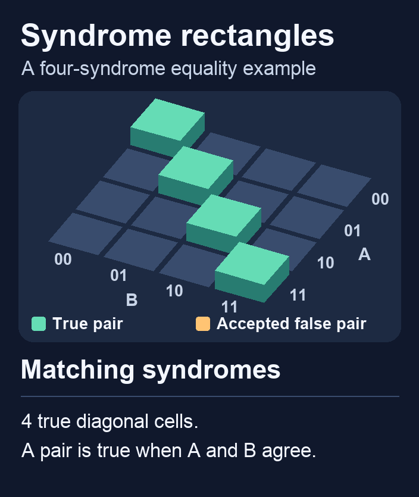

# Strong approximation of Tseitin codes without determinism

  

For a family of cubic 3-connected graphs with m edges, approximating the even-edge-subgraph predicate still requires DNNF size exponential in m. The bound holds at every fixed relative symmetric-difference error below one. The circuit may use overlapping OR branches.

[Read the paper](paper/manuscript.pdf) · [LaTeX source](paper/manuscript.tex) · [Proof outline](proof/PROBLEM_AND_PROOF.md) · [Run the replay](REPRODUCIBILITY.md)

## Why overlaps do not break the bound

A true pair has equal left and right syndromes. In the example, two rectangles both accept the false pair (00, 01). It appears twice across the rectangles but contributes only one error to their union. The proof bounds each rectangle separately and adds only the number of true points it can cover.

[Download the offline explorer](https://raw.githubusercontent.com/DannyExperiments/strong-approximation-tseitin-dnnf/refs/tags/v1.0.0/visualization/syndrome-rectangles-explorer.zip), extract the ZIP and open index.html. Rotate the matrix and choose rows and columns to see which false pairs your rectangle accepts. [Figure guide](visualization/README.md)

## Source and affine-code companion

The result answers the uniform strong-error case of Open Question 1 in de Colnet’s thesis. A companion result gives lower bounds in terms of the branchwidth of a nonempty affine binary code. It also gives an exact deterministic structured construction from a supplied vtree. [Thesis, §2.5](https://alexisdec.github.io/assets/pdf/thesis_deColnet.pdf#page=74) · [Pinned Q515](https://github.com/10m-u/open-problems-catalog/blob/ca8d4d44ba3db527f19f28928c240168f545ecfe/problems/computer_science_ai/theory-of-computation-algorithms-part-1.md#q515)

[Mathematical audit](audits/public_safe_reports/MATHEMATICAL_AUDIT.md) · [Literature audit](audits/public_safe_reports/LITERATURE_AUDIT.md) · [Scope](CLAIM_SCOPE_AND_LIMITATIONS.md) · [AI disclosure](AI_DISCLOSURE.md) · [Status](STATUS.md)

[Release v1.0.0](https://github.com/DannyExperiments/strong-approximation-tseitin-dnnf/releases/tag/v1.0.0) · [Version DOI](https://doi.org/10.5281/zenodo.24571970) · [Citation](CITATION.cff)

## Lean verification

For selected accepted diagonal pairs whose off-diagonal cross pairs are forbidden, choosing any covering product rectangle inside the accepting set gives an injective assignment of selected indices to rectangles. The selection-size estimate, DNNF cover construction and exponential bounds are proved in the paper. [Lean source and replay](formalization/README.md)
